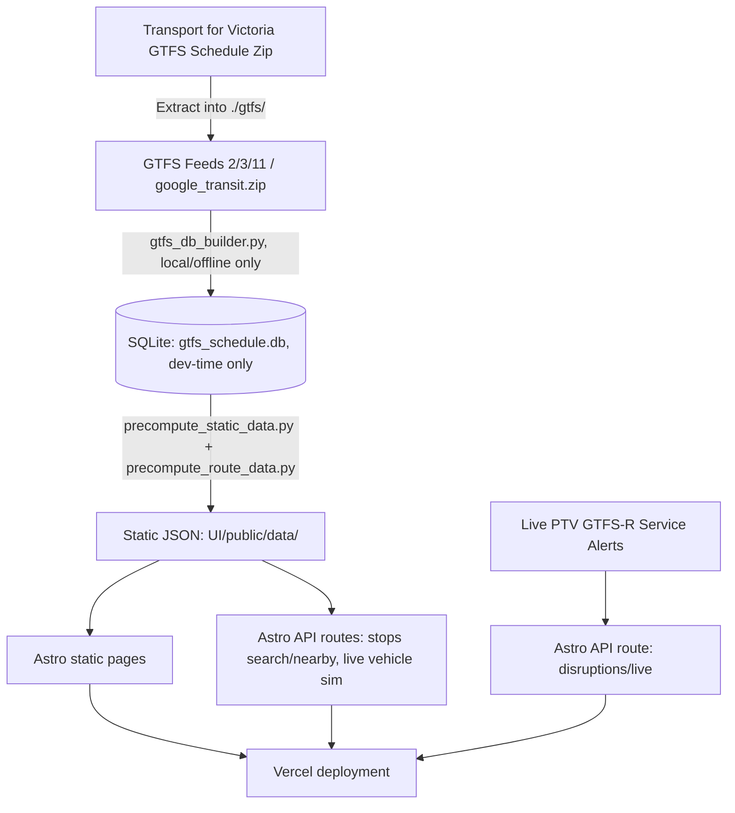

# Motion: Live Transit Visualization & Search

Motion is a live 3D visualization and exploration tool for the Victorian Public Transport (PTV / Transport for Victoria) network. It's a single Astro app (`UI/`) - a static Astro + React + Mapbox GL 3D frontend, plus a handful of Astro API routes (`UI/src/pages/api/`) that serve live train/tram position simulation, live PTV disruption alerts, and transit stop/landmark search. There's no separate backend service: the GTFS schedule data is baked into static JSON at build/data-prep time, and the only things fetched live at request time are the PTV GTFS-Realtime alert feeds. Deploys as one Vercel project (`@astrojs/vercel` adapter).

---

## Architecture & Data Pipeline



The SQLite database only ever exists on a developer's machine while running the precompute scripts - it's never deployed, never queried at request time, and isn't part of the Vercel bundle.

---

## 1. Prerequisites & Environment Setup

### 1.1 Python (offline data-prep tooling only)
The only Python in this repo is offline tooling to go from raw GTFS zips to the static JSON the app actually serves (`gtfs_db_builder/`, `precompute_route_data/`, `server/services/` as a small support library for those scripts) - standard library only, no third-party packages needed. Any Python 3.11+ interpreter works; `environment.yml` is a snapshot of one developer's conda environment, not a hard requirement.

### 1.2 PTV & Mapbox Key Configuration
Create a `.env` file in the project root (Astro's `envDir` points here) to configure live GTFS-Realtime alert queries and the Mapbox 3D map:

```bash
PTVOpenDataAPIKey=YOUR_PTV_API_KEY
PUBLIC_MAPBOX_TOKEN=pk.your_mapbox_token_here
```

### 1.3 Web App (Astro + React + Mapbox 3D + API routes)
The whole app - static frontend and API routes - lives in [`UI/`](file:///Users/lucidmach/Motion/UI), built with **Astro** and managed via **pnpm**:

```bash
# Install dependencies
pnpm install

# Start development server (http://localhost:3000) - serves both the
# static pages and the /api/* routes
pnpm dev

# Build for production (outputs .vercel/output/, ready for `vercel deploy`)
pnpm build
```

---

## 2. Downloading GTFS Schedule Data

The static schedule timetable data is provided by the Victorian Department of Transport and Planning via DataVic:

🔗 **Download Page**: [Transport for Victoria GTFS Schedule Dataset](https://opendata.transport.vic.gov.au/dataset/gtfs-schedule)

### 2.1 Download Steps
1. Navigate to the [GTFS Schedule Dataset](https://opendata.transport.vic.gov.au/dataset/gtfs-schedule) page on the DataVic Open Data Portal.
2. Download the latest GTFS Schedule release archive (usually named `gtfs.zip` or full package).
3. Extract the contents into the `gtfs/` directory in the repository root.

### 2.2 Feed Directory Layout
After extraction, your `gtfs/` directory should follow this structure:

```
gtfs/
├── 1/   # Regional Train (V/Line Train)
│   └── google_transit.zip
├── 2/   # Metropolitan Train (Metro Trains Melbourne)
│   └── google_transit.zip
├── 3/   # Metropolitan Tram (Yarra Trams)
│   └── google_transit.zip
├── 4/   # Metropolitan Bus (bundled with some regional town-bus routes)
│   └── google_transit.zip
├── 5/   # Regional Coach
│   └── google_transit.zip
├── 6/   # Regional Bus
│   └── google_transit.zip
├── 10/  # Interstate
│   └── google_transit.zip
└── 11/  # SkyBus
    └── google_transit.zip
```

> **Note**: Both `gtfs/` and `gtfs_schedule.db` are gitignored to avoid committing massive binaries.

---

## 3. Building `gtfs_schedule.db`

The database builder parses the GTFS feeds, normalizes timestamps into seconds past midnight (`arrival_time_secs`, `departure_time_secs`), and creates optimized B-tree indexes.

### 3.1 Build Database (Metro Train + Tram + SkyBus, no bus network)
Motion only serves Metro Train (2), Metro Tram (3), and SkyBus (11) - the
metro bus network is intentionally excluded (not needed for now):

```bash
python gtfs_db_builder/gtfs_db_builder.py \
  ./gtfs/2/google_transit.zip \
  ./gtfs/3/google_transit.zip \
  ./gtfs/11/google_transit.zip
```

To include the metro bus feed (4, filtered to `route_type=3` to drop the
regional town-bus routes bundled into the same zip) or the regional feeds
(Regional Train `1`, Regional Coach `5`, Regional Bus `6`, Interstate `10`),
pass them explicitly - note this multiplies the database size, which matters
more now than it used to since the live vehicle simulation data gets fully
baked into static JSON shipped with the app (see §4):
```bash
python gtfs_db_builder/gtfs_db_builder.py ./gtfs/*/google_transit.zip
```

### 3.2 Quick / Minimal Build (Metro Train & Tram Only)
For faster local iteration and testing:
```bash
python gtfs_db_builder/gtfs_db_builder.py ./gtfs/2/google_transit.zip ./gtfs/3/google_transit.zip
```

### 3.3 Mock Dataset (Offline / Testing Mode)
If no GTFS zip files are supplied, the builder synthesizes a mock multi-modal network for development:
```bash
python gtfs_db_builder/gtfs_db_builder.py
```

---

## 4. Precomputing the Static Data the App Actually Serves

After populating `gtfs_schedule.db`, bake it down into the static JSON the Astro app reads - no database is queried at runtime:

```bash
python gtfs_db_builder/precompute_static_data.py
python precompute_route_data/precompute_route_data.py
```

- `precompute_static_data.py` writes `UI/public/data/stops.json`, `UI/public/data/routes.json` (used by stop search/nearby and disruption route-name resolution), and `UI/public/data/vehicle-sim/<weekday>.json` - one file per weekday, each the full day's bracketing stop-to-stop segments for every active train/tram trip, which `UI/src/pages/api/network/vehicles/live.ts` filters by the current time at request time. See `gtfs_db_builder/precompute_static_data.py`'s module docstring for the accepted tradeoff this implies (a GTFS timetable revision or one-off calendar exception won't be reflected until this script is re-run).
- `precompute_route_data.py` writes the per-route shape/stop files under `UI/public/data/transit/routes/<mode>/<route>/`, used by the TransitDock route picker.

Re-run both whenever `gtfs_schedule.db` is rebuilt.

---

## 5. Interactive 3D Web UI & Search Engine

The frontend located in [`UI/`](file:///Users/lucidmach/Motion/UI) provides an interactive 3D map interface:

- **Bottom Search Bar Island**: Glassmorphic search interface (`SearchBar.tsx`) with instant keyboard access (`Enter` to focus/search, `Esc` back/clear hierarchy, `↑/↓` arrow key option cycling).
- **Live Dynamic Geocoding**: Resolves university faculties, landmarks, and street addresses across Victoria in real time via **OpenStreetMap Nominatim** merged with over 27,000+ local **GTFS transit stops**.
- **100% Fixed WebGL 3D Target Dot**: Destination pin rendered natively in WebGL on the GPU with pulsing radar rings (`motion-search-target-core`), mathematically locked to map coordinates with zero drift during 360° orbit, pan, and tilt (0° to 85°).
- **Spatial Region Engine**: Real-time bounding box and proximity resolver displaying the active corridor (e.g., `Melbourne CBD`, `Monash Innovation Hub`, `Richmond Interchange`).

---

## 6. Running the Test Suite

Run the Python unit tests for the offline data-prep tooling:

```bash
python -m pytest directional_routing/ server/services/
```

Frontend production build and test suite (covers the Astro API routes too - `astro build` type-checks and bundles them, `astro check` runs a full TypeScript pass):
```bash
cd UI && pnpm build
cd UI && pnpm test
cd UI && npx astro check
```

This verifies:
1. GTFS zip parsing, route-shape extraction, and the shared geo utilities (haversine, bearing, mode names).
2. The frontend build, including every `UI/src/pages/api/*.ts` route.
3. `UI/src/lib/` - stop search ranking, live vehicle position simulation (progress/dwelling state, track-shape snapping, the overnight-trip-past-midnight case), GTFS-Realtime protobuf decoding (against a fixture built with Python's real `gtfs_realtime_pb2`, not hand-crafted bytes), disruption alert parsing/time-window filtering, route-list building, Nominatim throttling/caching, and the core geo/geometry math - each colocated as `*.test.ts` next to the module it covers.
4. Existing component tests (TransitDock).

---

## 7. Project Structure

```
.
├── directional_routing/        # Shared geo utilities (DB_NAME, haversine, bearing, mode names)
│   ├── directional_routing.py
│   ├── directional_routing.spec.md
│   └── test_directional_routing.py
├── gtfs/                       # Raw GTFS schedule archives (gitignored)
│   ├── 1..11/google_transit.zip
├── gtfs_db_builder/            # Offline: SQLite ingestion + static-JSON precompute
│   ├── gtfs_db_builder.py
│   ├── precompute_static_data.py   # Bakes stops.json/routes.json/vehicle-sim/*.json
│   └── gtfs_db_builder.spec.md
├── precompute_route_data/      # Offline: per-route shape/stop JSON precompute
│   └── precompute_route_data.py
├── server/                     # Offline support library for the precompute scripts
│   └── services/
│       ├── network_service.py      # GTFS zip -> metro/tram lines & stations GeoJSON
│       └── route_shape_service.py  # Per-mode route lists + per-route shape/stop lookup
├── UI/                          # Astro 5 + React 19 + Mapbox 3D app - static pages + API routes
│   ├── public/data/             # Precomputed static JSON the app actually serves at runtime
│   │   ├── stops.json, routes.json, vehicle-sim/<weekday>.json
│   │   └── transit/              # Metro/tram line GeoJSON, per-route shape/stop files
│   ├── src/components/           # HeaderHUD, SearchBar, TransitDock, MapboxMap, TokenModal
│   ├── src/lib/                  # Ported backend logic: geo math, vehicle sim, geocoding search,
│   │                              # GTFS-Realtime protobuf decode, static-data loading/caching
│   ├── src/pages/api/            # Live API routes: stops search/nearby, vehicles/live,
│   │                              # disruptions/live, health, status
│   ├── src/scripts/map/          # MotionMapController, WebGL Search Marker, Region Resolver
│   ├── src/services/api.ts       # Client API - same-origin now, no separate backend URL
│   └── ARCHITECTURE.md           # UI Architecture & Event Bus Specification
├── CHANGELOG.md                 # Project version history & UI changelog
├── environment.yml              # One developer's conda environment snapshot (not required)
├── gtfs_schedule.db              # SQLite database (gitignored, dev-time only, never deployed)
└── README.md                    # Project documentation
```
